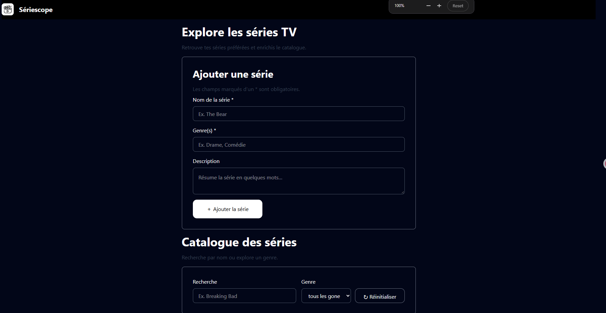
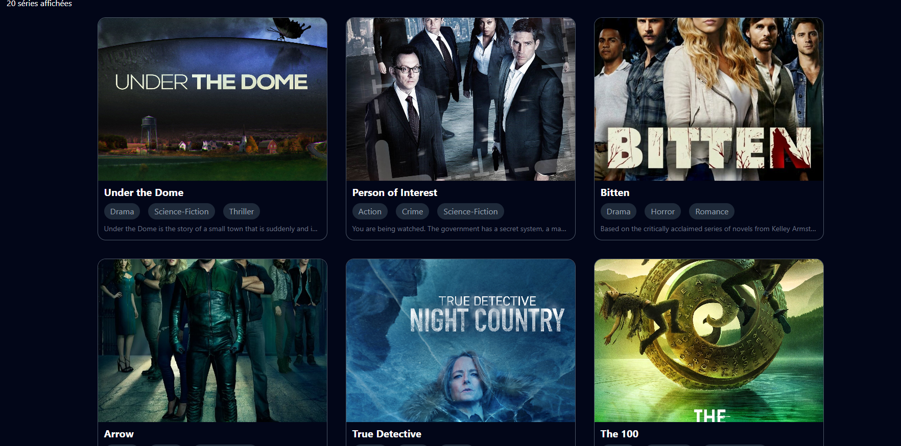
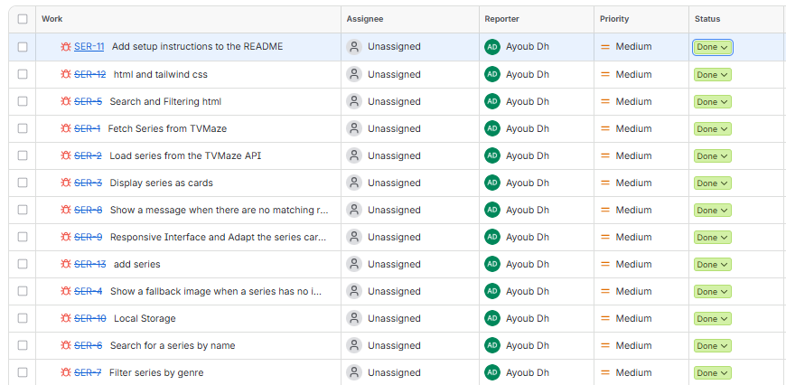

# 📺 Series Explorer

Petite app web qui affiche des séries TV depuis **TVMaze**, avec recherche,
filtre par genre et mise en cache dans le navigateur.






## ✨ Fonctionnalités

- 20 séries chargées depuis l'API au premier lancement
- Cartes de taille fixe (image, nom, genre, note, résumé)
- 🔎 Recherche par nom (instantanée, `input`)
- 🎭 Filtre par genre (`<select>` rempli depuis l'API)
- Compteur `X séries affichées` + message `Aucune série` si résultat vide
- 💾 Cache `localStorage` → plus de requête au rechargement

## 🛠️ Technologies

| | |
|---|---|
| HTML / JS vanilla | `async / await`, `fetch`, `Array`, `Set` |
| Tailwind CSS | via CDN dans `index.html` |
| API | [TVMaze](https://www.tvmaze.com/api) (gratuite, sans clé) |

## 🚀 Lancer le projet

> ⚠️ Ouvre pas le fichier directement en `file://` → utilise un petit serveur.

**VS Code** : clic droit sur `index.html` → *Open with Live Server*

**Ou en terminal :**
```bash
python -m http.server 5500
# puis http://localhost:5500
```

## 📁 Structure

```
projet/
├── index.html          # section #list_serie, #recherche, #genre, #voide
├── app.js              # fetch, cache, displaySeries(), search_sort()
├── assets/
│   └── img/
│       └── fallback.jpg    # image si serie.image === null
└── README.md
```

## 🔌 API utilisée

```
GET https://api.tvmaze.com/shows?page=0     → 240 séries
```

Chaque série contient : `name`, `genres[]`, `rating.average`,
`image.medium / image.original`, `summary` (avec du HTML → `innerHTML`).

Les genres sont extraits **avant** de couper à 20 :
```js
const noms = [...new Set(datare.flatMap(s => s?.genres ?? []))].sort();
```

## 💾 Cache (localStorage)

| Clé | Contenu |
|---|---|
| `data` | les séries affichées |

Pour forcer un nouveau téléchargement (Console du navigateur) :
```js
localStorage.removeItem("data");
location.reload();
```

## 🧠 3 règles du code

1. `await resp.json()` → `.json()` retourne aussi une **Promise**.
2. `displaySeries(list = data)` est appelée **après** le fetch / le cache, et après chaque filtre.
3. `data` = source (ne jamais la remplacer par le résultat du filtre), `search_res` = uniquement pour l'affichage.

## 🐛 Dépannage

| Problème | Solution |
|---|---|
| Page vide au reload | vider le cache (voir ci-dessus) |
| `Aucune série` avec un genre | le genre existe dans les 240 mais pas dans les 20 affichées → normal |
| Image cassée | vérifier `assets/img/fallback.jpg` et `img.src` (pas `"src="`) |
| `line-clamp-3` ne marche pas | Tailwind récent, sinon garder `overflow-hidden` |

---

# 📺 Series Explorer

## GitHub
[💻 GitHub](https://github.com/ayoub-dehbi/S-rieScope)

## Live Demo
[🌐 Live Demo](https://seriescope-roan.vercel.app/)

## jira




Fait avec ❤️ + un peu de ☕ (et beaucoup de `console.log` 😄).
